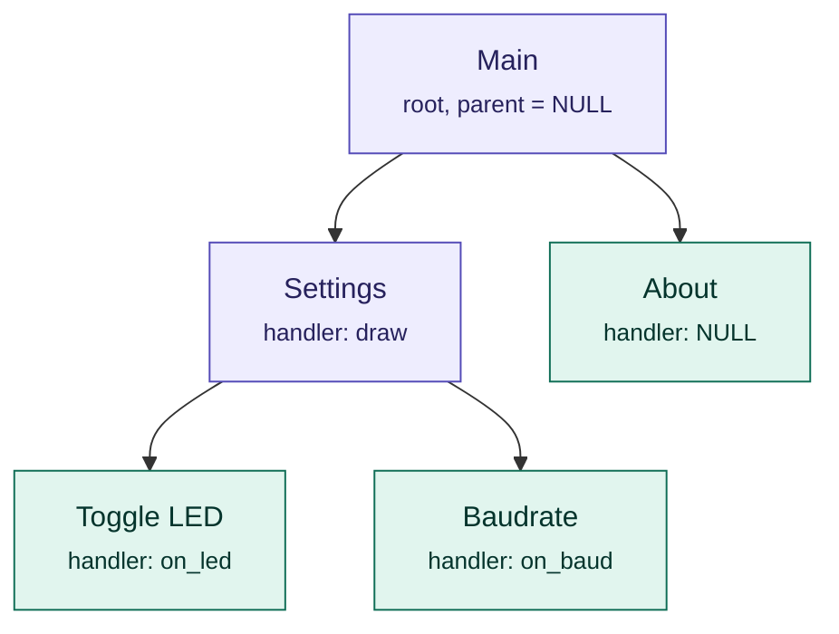

# embedded-menu

A tiny, **allocation-free** tree menu engine for embedded C (C99).

- No `malloc`, no recursion, no platform dependencies
- Works with any display (LCD, OLED, UART terminal) and any input (buttons, encoder, keyboard)
- Two files: `menu.h` + `menu.c`
- Compile-time configuration via macros

The library handles **navigation and state only**. *How* a page is drawn is up to you, via a handler callback.

## Concept

The menu is a tree of pages. Each page has a title, an optional parent, up to `MENU_MAX_CHILDREN` children, a highlighted child, and an optional handler.

```
Main
├── Settings
│   ├── Toggle LED   (handler: on_led)
│   └── Baudrate     (handler: on_baud)
└── About
```

The same tree as a diagram (rendered automatically by GitHub):



Purple = page with children (entering it makes it the current page). Teal = leaf (entering it runs its handler).

A `menu_t` controller tracks the *current* page. Your input code calls `menu_next / menu_prev / menu_enter / menu_back`.

**Handler rules**

| Situation | What happens |
|---|---|
| `menu_enter()` on a child that has children | it becomes the current page, then its handler is called |
| `menu_enter()` on a leaf | its handler is called (use it as an "action") |
| `menu_back()` | the parent becomes current, then its handler is called (so it can redraw) |

## Quick start

```c
#include "menu.h"

static menu_t menu;
static menu_page_t root, settings, led;

static void draw(menu_page_t *page)  { /* draw page->text and its children */ }
static void toggle_led(menu_page_t *self) { /* do something */ }

void app_init(void)
{
    menu_page_init(&root,     0, "Main",       draw);
    menu_page_init(&settings, 1, "Settings",   draw);
    menu_page_init(&led,      2, "Toggle LED", toggle_led);

    menu_add_child(&root, &settings);
    menu_add_child(&settings, &led);

    menu_init(&menu, &root);
    draw(menu_current(&menu));
}

/* Call from your button / encoder code */
void on_up(void)    { menu_prev(&menu);  draw(menu_current(&menu)); }
void on_down(void)  { menu_next(&menu);  draw(menu_current(&menu)); }
void on_ok(void)    { menu_enter(&menu); }
void on_back(void)  { menu_back(&menu);  }
```

Drawing a page is just iterating its children:

```c
for (uint8_t i = 0; i < page->child_count; i++) {
    bool hl = (i == page->selected);
    lcd_print(page->children[i]->text, hl);
}
```

## API

| Function | Description |
|---|---|
| `menu_page_init(page, id, text, handler)` | Initialize a page (zeroes all fields, safe-copies the title) |
| `menu_add_child(parent, child)` | Attach a child; returns `MENU_ERR_FULL` if the parent is full |
| `menu_init(menu, root)` | Start the controller at `root` |
| `menu_next / menu_prev(menu)` | Move highlight (wraps around) |
| `menu_enter(menu)` | Activate the highlighted child |
| `menu_back(menu)` | Go to the parent page |
| `menu_current(menu)` | Get the current page |
| `menu_selected_child(page)` | Get the highlighted child (or `NULL`) |

## Configuration

Override at compile time (`-DMENU_MAX_CHILDREN=8`) or before including the header:

| Macro | Default | Meaning |
|---|---|---|
| `MENU_MAX_CHILDREN` | 5 | Max children per page |
| `MENU_TEXT_LEN` | 20 | Title buffer size (including `'\0'`) |

Each page costs roughly `MENU_TEXT_LEN + MENU_MAX_CHILDREN * sizeof(void*) + ~12` bytes of RAM.

## Build the demo

```sh
make
./demo      # w = up, s = down, e = enter, b = back, q = quit
```

## Notes

- Pages must outlive the menu (use `static` or globals, not stack variables of a returning function).
- Not thread/ISR safe: call the API from one context only (e.g. the main loop). If buttons are read in an ISR, set a flag there and call the menu from the main loop.
