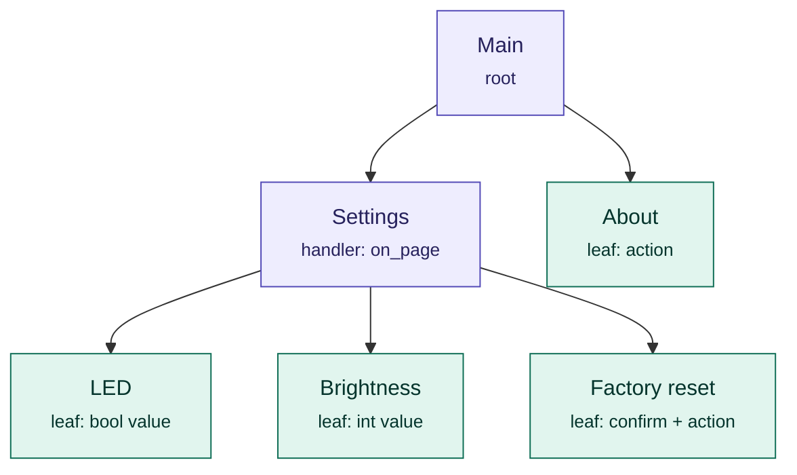

# embedded-menu

A tiny, **allocation-free** tree menu engine for embedded C (C99).

- No `malloc`, no recursion, no platform dependencies
- Works with any display (LCD, OLED, UART terminal) and any input (buttons, rotary encoder, keyboard)
- Two files: `menu.h` + `menu.c`, about 2.2 KB of Flash on a Cortex-M3 (`-Os`)
- The whole tree can be `const` and live in **Flash**: the only RAM used is one `menu_t` (68 bytes with the default depth)
- Built in: editing int / bool / enum values, hidden and disabled items, Yes/No confirmation, a scrolling view for small displays, an inactivity timeout, jumping to any page, and breadcrumbs

The library handles **navigation and state only**. *How* a page is drawn is up to you, via a handler callback.

## Concept

The menu is a tree of pages. Each page has a title, any number of children (up to 255), and an optional handler.

```
Main
├── Settings
│   ├── LED            (bool value)
│   ├── Brightness     (int value 0..100)
│   └── Factory reset  (asks Yes/No)
└── About
```

The same tree as a diagram (rendered automatically by GitHub):



Purple = page with children (entering it makes it the current page). Teal = leaf (entering it runs an action, edits a value, or asks for confirmation).

Pages hold only constant data. All runtime state (the current path, what's highlighted on each level, what's being edited, the timeout counter) lives in one `menu_t`. Your input code calls `menu_input()` (or `menu_next / prev / enter / back`), and the library tells your handlers when to draw.

## Quick start

```c
#include "menu.h"

static bool    led_on;
static int32_t brightness = 50;

static const menu_value_t led_value        = MENU_VALUE_BOOL_INIT(&led_on);
static const menu_value_t brightness_value = MENU_VALUE_INT_INIT(&brightness, 0, 100, 10);

static void on_page(menu_t *menu, const menu_page_t *self, menu_event_t event)
{
    (void)self; (void)event;
    draw(menu);                               /* your display code, see below */
}

static void on_reset(menu_t *menu, const menu_page_t *self, menu_event_t event)
{
    (void)menu; (void)self;
    if (event == MENU_EVT_ACTION) factory_reset();
}

/* Declare every page first so they can point at each other... */
MENU_PAGE_DECLARE(pg_main);
MENU_PAGE_DECLARE(pg_led);
MENU_PAGE_DECLARE(pg_brightness);
MENU_PAGE_DECLARE(pg_reset);

/* ...then define them. Everything here is const: it stays in Flash. */
MENU_PAGE_DEFINE(pg_main,       .text = "Main", .handler = on_page,
                                .first_child = &pg_led);
MENU_PAGE_DEFINE(pg_led,        .text = "LED", .value = &led_value,
                                .next_sibling = &pg_brightness);
MENU_PAGE_DEFINE(pg_brightness, .text = "Brightness", .value = &brightness_value,
                                .next_sibling = &pg_reset);
MENU_PAGE_DEFINE(pg_reset,      .text = "Factory reset", .handler = on_reset,
                                .flags = MENU_FLAG_CONFIRM);

static menu_t menu;

void app_init(void)
{
    menu_init(&menu, &pg_main);               /* draws Main */
    menu_set_timeout(&menu, 30000);           /* back to Main after 30 s idle */
}

/* Buttons: no drawing needed here. */
void on_button(menu_key_t key) { menu_input(&menu, key); }

/* Rotary encoder: */
void on_encoder(int8_t steps)  { menu_scroll(&menu, steps); }

/* SysTick or main loop: */
void every_10ms(void)          { menu_tick(&menu, 10); }
```

### Drawing

`menu_view()` gives you the rows to draw on a display with `ROWS` lines, already scrolled so the highlight is visible and with hidden items left out:

```c
void draw(menu_t *menu)
{
    menu_item_t items[ROWS];
    uint8_t n = menu_view(menu, items, ROWS);

    if (menu_mode(menu) == MENU_MODE_CONFIRM) {
        lcd_printf("%s?  %s", menu_active(menu)->text,
                   menu_confirm_yes(menu) ? "[Yes] No" : "Yes [No]");
        return;
    }
    for (uint8_t i = 0; i < n; i++) {
        const menu_page_t *p = items[i].page;
        lcd_print_row(i, p->text, items[i].selected, items[i].disabled);
        if (p->value != NULL) {
            const char *label = menu_value_label(menu, p);   /* enum text, or NULL */
            int32_t v = menu_value_get(menu, p);            /* shows the edit in progress */
            lcd_print_value(i, label, v, items[i].editing);
        }
    }
}
```

For a breadcrumb title (`Main > Settings`), loop `menu_path(menu, 0 .. menu_depth(menu))`.

You can also build the tree at runtime instead, for example when menu items depend on what hardware is present:

```c
static menu_page_t root, led;
menu_page_init(&root, 0, "Main", on_page);
menu_page_init(&led,  1, "LED",  NULL);
led.value = &led_value;
menu_add_child(&root, &led);
```

## Events

A handler is `void handler(menu_t *menu, const menu_page_t *self, menu_event_t event)`.

| Call | Events sent |
|---|---|
| `menu_init()`, `menu_home()` | `ENTER` → root |
| `menu_next()` / `menu_prev()` | `SELECT` → current page (`REFRESH` while editing or confirming) |
| `menu_enter()` on a page with children | it becomes current, `ENTER` → that page |
| `menu_enter()` on a plain leaf | `ACTION` → leaf, then `REFRESH` → current page |
| `menu_enter()` on a bool value | the bool is toggled, `VALUE_CHANGED` → leaf, `REFRESH` → current page |
| `menu_enter()` on an int / enum value | edit mode starts, `REFRESH` → current page |
| `menu_enter()` while editing | the value is saved, `VALUE_CHANGED` → leaf (only if it changed), `REFRESH` |
| `menu_enter()` on a `MENU_FLAG_CONFIRM` leaf | confirm mode starts (answer defaults to No), `REFRESH` |
| `menu_enter()` while confirming | on Yes: `ACTION` → leaf. Then `REFRESH` |
| `menu_back()` | parent becomes current, `BACK` → parent. While editing / confirming: cancels, `REFRESH` |
| `menu_goto(page)` | `ENTER` → the page (or to its parent, with it highlighted, if it's a leaf) |
| `menu_refresh()` | `REFRESH` → current page |
| `menu_tick()` reaches the timeout | edit / confirm cancelled, back to root, `TIMEOUT` → root |

`ENTER`, `BACK`, `SELECT`, `REFRESH` and `TIMEOUT` all mean "draw yourself", so a page handler can usually ignore the event. A leaf handler only needs `ACTION` or `VALUE_CHANGED` (for example, to save to EEPROM). The library writes the variable itself.

## Features

**Values.** Point `.value` at a `menu_value_t`:

| Macro | Variable | Behaviour |
|---|---|---|
| `MENU_VALUE_INT_INIT(&v, min, max, step)` | `int32_t` | Edit mode, clamped to min..max |
| `MENU_VALUE_BOOL_INIT(&v)` | `bool` | Toggles straight away on Enter |
| `MENU_VALUE_ENUM_INIT(&v, options)` | `uint8_t` index | Edit mode, wraps through `options[]` (a real array) |

While editing, `MENU_KEY_UP` and encoder clockwise increase the value. Enter saves it, Back cancels.

**Hidden / disabled items.** Set `.state` to a function that returns `MENU_ITEM_NORMAL`, `MENU_ITEM_DISABLED` (drawn, but can't be highlighted) or `MENU_ITEM_HIDDEN` (not drawn). It's checked whenever the menu moves or is drawn, so items can appear when the hardware they need is detected.

**Confirmation.** `.flags = MENU_FLAG_CONFIRM` on an action leaf asks Yes/No before `ACTION` is sent.

**Shared handlers.** `.user` is a free pointer, so one handler can serve several pages (for example, `.user = &beep_ms`).

**Input.** `menu_input(menu, MENU_KEY_UP / DOWN / ENTER / BACK / HOME)` for buttons, `menu_scroll(menu, delta)` for a rotary encoder (one redraw per call, however many steps).

**Timeout.** `menu_set_timeout(menu, ms)` and call `menu_tick(menu, elapsed_ms)` regularly. Every key resets the timer. The timeout fires once and stays quiet until the next key.

**Jumping.** `menu_goto(menu, page)` finds the page anywhere in the tree (no parent pointers needed) and rebuilds the path, so Back works as if the user had walked there. `menu_home()` returns to root.

## API

| Function | Description |
|---|---|
| `menu_page_init(page, id, text, handler)` | Initialize a runtime page (zeroes all fields). `text` is stored as a pointer |
| `menu_add_child(parent, child)` | Append a runtime child. Errors: `HAS_PARENT`, `LOOP`, `FULL` (255) |
| `menu_init(menu, root)` | Start at `root` and send it `ENTER` |
| `menu_next / menu_prev(menu)` | Move highlight (wraps, skips hidden/disabled), or change the value being edited |
| `menu_enter(menu)` | Open / run / edit / toggle / confirm, or accept |
| `menu_back(menu)` | Go to the parent, or cancel |
| `menu_home(menu)` | Go to root |
| `menu_goto(menu, page)` | Jump to a page. Errors: `NOT_FOUND`, `DEPTH` |
| `menu_input(menu, key)` | Button helper |
| `menu_scroll(menu, delta)` | Encoder helper |
| `menu_refresh(menu)` | Ask the current page to redraw |
| `menu_set_timeout(menu, ms)` / `menu_tick(menu, ms)` | Inactivity timeout |
| `menu_view(menu, items, rows)` | Rows to draw, scrolled |
| `menu_value_get(menu, page)` / `menu_value_label(menu, page)` | Value to show / enum text |
| `menu_current`, `menu_selected_child`, `menu_selected_index` | Where we are |
| `menu_depth`, `menu_path(menu, level)` | Breadcrumbs |
| `menu_mode`, `menu_active`, `menu_confirm_yes` | Edit / confirm state |
| `menu_child_count`, `menu_child_at`, `menu_item_state` | Tree helpers |

## Configuration

| Macro | Default | Meaning |
|---|---|---|
| `MENU_MAX_DEPTH` | 8 | Max tree levels, root included. Each level costs 6 bytes of RAM in `menu_t` |

`MENU_MAX_DEPTH` changes the size of `menu_t`, so **`menu.c` and all your files must see the same value**. Set it either as a compiler flag for the whole project (`-DMENU_MAX_DEPTH=10`), or in a `menu_config.h` on your include path and build with `-DMENU_USE_CONFIG_FILE`. Don't `#define` it in a single `.c` file before including `menu.h`.

## Migrating from the first version

- Handlers are now `void h(menu_t *menu, const menu_page_t *self, menu_event_t event)`.
- `menu_init()` draws the root and `menu_next/prev()` send `SELECT`, so remove manual `draw()` calls after them.
- The highlight moved from `page->selected` into `menu_t`: use `menu_selected_index(menu)` or `menu_view()`.
- `page->children[i]` and `page->child_count` are gone: walk `first_child` / `next_sibling`, or use `menu_child_at()` / `menu_child_count()`.
- `page->text` is a `const char *`: pass strings that live as long as the page.
- `menu_selected_child()` now takes the `menu_t`.
- `MENU_TEXT_LEN` and the `MENU_MAX_CHILDREN` setting are gone.

## Build the demo and tests

The demo in [`examples/demo.c`](examples/demo.c) runs on a PC and draws a const menu tree with `printf`, as if on a 4-line display. It shows every feature. To use it on a board, swap `draw()` for your display code and the `getchar()` loop for your buttons.

```sh
make
./demo      # w/s = up/down, e = enter, b = back, h = home, g = goto, t = +10 s, q = quit
make test   # host-side unit tests
```

## Notes

- Pages, title strings and value variables must outlive the menu (use `static` or globals).
- Don't pass pages of a `const` tree to `menu_add_child()`, and don't mix runtime and `const` pages under one parent.
- Not thread/ISR safe: call the API from one context only (e.g. the main loop). If buttons are read in an ISR, set a flag there and call the menu from the main loop.
- Child lists are walked linearly. With menu-sized lists (a handful of items) this doesn't matter.

## License

MIT, see [LICENSE](LICENSE).
